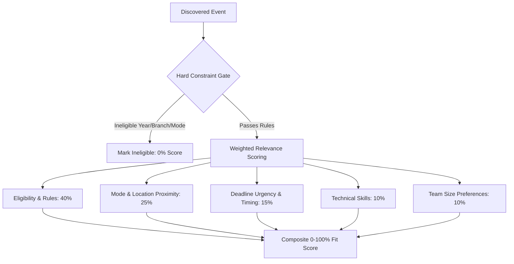

# Contesthon — Intelligent Opportunity Assistant

**Event:** Kritical Hacks 2026 • AI/ML Student Track  
**Product Definition:** Contesthon is a personalized opportunity assistant that discovers relevant hackathons, coding contests, and fellowships across the live web using TinyFish, explains why they fit using Google Gemini, and prepares application forms while keeping final review and submission in the student's hands.

---

## ⚡ Quick Start

### 1. Prerequisites
- Node.js (v18+)
- pnpm / npm
- TinyFish API Key ([tinyfish.ai](https://www.tinyfish.ai))
- Google Gemini API Key ([aistudio.google.com](https://aistudio.google.com))

### 2. Environment Configuration

Create `.env` in `contesthon-backend/`:
```env
PORT=3001
TINYFISH_API_KEY=your_tinyfish_api_key_here
GEMINI_API_KEY=your_gemini_api_key_here
FIREBASE_API_KEY=your_firebase_api_key_here
FIREBASE_PROJECT_ID=your_firebase_project_id
```

Create `.env` in `contesthon-frontend/`:
```env
VITE_API_URL=http://localhost:3001/api
```

### 3. Run the Applications

#### Option A: One-Click (Windows)
Double-click `start-dev.bat` in the repository root.

#### Option B: Terminal Commands
**Terminal 1 — Backend API (Port 3001):**
```bash
cd contesthon-backend
pnpm dev
```

**Terminal 2 — Frontend App (Port 5173):**
```bash
cd contesthon-frontend
pnpm dev
```

Open **[http://localhost:5173](http://localhost:5173)** in your browser.

---

## 🛠️ Technology Stack

| Layer | Technology | Purpose |
| :--- | :--- | :--- |
| **Frontend** | React 19, Vite, TypeScript | Fast, responsive Single Page Application |
| **Styling & UI** | Tailwind CSS, Lucide Icons | Accessible, modern, customized student dashboard |
| **Backend API** | Node.js, Express, TypeScript | REST API, orchestration, caching, validation |
| **Web Intelligence** | TinyFish Search & Fetch APIs | Live web discovery and DOM content extraction |
| **AI Extraction & Reasoning** | Google Gemini (3.5 Flash) | Structured JSON extraction from webpage content |
| **Authentication & Database**| Firebase Auth, Cloud Firestore | Student authentication and resilient document store |
| **Matching Engine** | Custom 2-step deterministic algorithm | Hard eligibility gate + weighted relevance scoring |

---

## 📋 Product Vision & Core Objectives

### The Problem
Students often miss prestigious hackathons, coding contests, fellowships, and research opportunities because information is scattered across hundreds of event portals and social feeds. Eligibility constraints and deadlines are tedious to compare, and repetitive form-filling causes registration fatigue.

### The Solution: Contesthon
- **Live Opportunity Aggregation:** Uses TinyFish Search to find real, active registrations across the web without relying on manual database entries.
- **Deterministic Fact Extraction:** Uses TinyFish Fetch + Gemini AI to extract deadlines, eligibility rules, team sizes, locations, and prize pools into typed schemas.
- **Explainable Matching Engine:** Provides transparent 0–100% fit scores with plain-text justifications. Hard eligibility conflicts strictly block invalid applications.
- **Human-in-the-Loop Registration:** Pre-fills application fields using verified profile information, highlights missing questions, and stops before final submission. Never auto-submits.

---

## 🎯 Target Personas

| Persona | Core Need |
| :--- | :--- |
| **College Student** | Discover relevant hackathons and fellowships; track upcoming deadlines. |
| **Beginner Builder** | Understand eligibility rules, team requirements, and prerequisites clearly. |
| **Active Competitor** | Filter by location, prizes, mode (online/offline), and eliminate repetitive form-filling. |
| **College Club / Cell** | Curate verified opportunity feeds for student members. |

---

## 🧠 AI Matching & Deterministic Scoring Algorithm

Contest matching decouples **hard constraints** from **soft relevance scoring**:



### 1. Hard Constraint Filter (Binary Gate)
If any mandatory rule conflicts (e.g. event is for final-year students only, but user is in year 1; or event is strictly offline in another city and user requested online-only), the event is marked `isEligible = false` with an explicit reason. High relevance scores never bypass an eligibility conflict.

### 2. Weighted Signals (Configurable)
- **Eligibility & Restrictions:** 40%
- **Mode & Location:** 25% (incorporates geographic alignment)
- **Timing & Deadline Urgency:** 15%
- **Skills & Stack:** 10% (lowered to avoid penalizing students exploring new stacks)
- **Team Size Preference:** 10%

### 3. "Disable Skill Criteria" Option
Students can toggle **"Disable Skill Criteria"** directly on the dashboard or in their profile. When disabled:
- Skill weight is set to **0%**.
- Recommendations are computed strictly across eligibility, location, mode, and timing, allowing students to explore opportunities outside their current tech stack.

---

## 🌐 TinyFish Integration Architecture

Contesthon uses TinyFish exclusively through backend services so API keys are never exposed to the client bundle:

| Component | Endpoint | Role | Output |
| :--- | :--- | :--- | :--- |
| **TinyFish Search API** | `https://api.search.tinyfish.ai` | Discovers live opportunity URLs based on user profile and filters. | Candidate event links and search snippets. |
| **TinyFish Fetch API** | `https://api.fetch.tinyfish.ai` | Scrapes readable, boilerplate-free page text from target websites. | Token-efficient clean webpage text. |
| **Gemini Extraction** | `GoogleGenerativeAI` | Converts raw webpage text into structured event records. | Validated `EventRecord` JSON. |
| **Registration Assistant** | Form Mapping Engine | Maps verified profile fields to target form schemas. | Pre-filled preview awaiting user review. |

---

## 🗄️ Data Model Specifications

### `UserProfile`
```typescript
interface UserProfile {
  userId: string;
  name: string;
  email: string;
  college: string;
  year: number; // 1, 2, 3, 4, 5
  branch: string;
  skills: string[];
  interests: string[];
  preferredMode: 'online' | 'offline' | 'hybrid' | 'any';
  city: string;
  teamSizePreference: 'solo' | 'team' | 'any';
  ignoreSkills?: boolean; // When true, skill matching is bypassed
  createdAt: string;
  updatedAt: string;
}
```

### `EventRecord`
```typescript
interface EventRecord {
  eventId: string;
  title: string;
  organizer: string;
  description: string;
  sourceUrl: string;
  registrationUrl: string;
  eligibility: {
    minYear?: number;
    maxYear?: number;
    allowedBranches?: string[];
    allowedColleges?: string[];
    rawEligibilityText: string;
    isRestricted: boolean;
  };
  startDate: string | null;
  deadline: string | null;
  mode: 'online' | 'offline' | 'hybrid';
  location: string | null;
  isFree?: boolean; // Free vs Paid entry
  fee?: string | null;
  teamSize: { min: number; max: number };
  prizes: string | null;
  tags: string[];
  extractedAt: string;
  confidence: number;
}
```

### `ApplicationRecord`
```typescript
interface ApplicationRecord {
  applicationId: string;
  eventId: string;
  userId: string;
  status:
    | 'not_started'
    | 'preparing'
    | 'needs_user_input'
    | 'ready_for_review'
    | 'preparation_failed'
    | 'user_submitted'
    | 'confirmed';
  preparedFields: Record<string, string>;
  missingFields: string[];
  lastUpdatedAt: string;
  userConfirmedSubmission: boolean;
  agentNotes?: string;
}
```

---

## 🔒 Registration Assistant & Safety Guardrails

1. **Explicit User Trigger:** Registration preparation begins only when the user explicitly clicks "Prepare Application".
2. **Pre-Filling & Field Audit:** The assistant pre-populates verified profile attributes (Full Name, College, Email, Branch, City) and highlights missing questions (e.g. project pitch, custom tracks).
3. **No Auto-Submit Guarantee:** The assistant strictly halts at `ready_for_review`. The final submission is completed manually by the student on the official registration page.
4. **Non-Hallucination Policy:** Unknown dates, prizes, or eligibility criteria are stored as `null`. Missing facts are never guessed.
5. **Prompt Injection Sanitization:** All raw webpage content is treated strictly as untrusted data input.

---

## 📂 Repository Structure

```
Contesthon/
├── README.md                    # Unified Product Requirements & Documentation
├── start-dev.bat                # One-click Windows runner for backend & frontend
├── contesthon-backend/          # Node.js + Express + TypeScript Backend
│   ├── .env.example             # Environment template
│   ├── src/
│   │   ├── index.ts             # Express entry point
│   │   ├── config/firebase.ts   # Firestore configuration
│   │   ├── services/
│   │   │   ├── tinyfish.ts      # TinyFish Search & Fetch services
│   │   │   ├── gemini.ts        # Gemini 3.5 Flash schema extractor
│   │   │   ├── scoring.ts       # Deterministic scoring algorithm
│   │   │   └── store.ts         # Persistent data storage layer
│   │   ├── routes/
│   │   │   ├── profile.ts       # Student profile endpoints
│   │   │   ├── discover.ts      # Live discovery endpoint
│   │   │   ├── events.ts        # Event listings & filters
│   │   │   └── applications.ts  # Application tracking endpoints
│   │   └── types/index.ts       # TypeScript definitions
│   ├── tsconfig.json
│   └── package.json
└── contesthon-frontend/         # React 19 + Vite + Tailwind Frontend
    ├── .env.example             # Frontend environment template
    ├── index.html               # Main entry HTML
    ├── src/
    │   ├── api/client.ts        # Axios API client
    │   ├── hooks/useAuth.ts     # Firebase Auth hook
    │   ├── components/
    │   │   ├── Layout.tsx       # Sidebar navigation and header
    │   │   ├── EventCard.tsx    # Card with fit badge, fee & location
    │   │   ├── FitScoreBadge.tsx# Color-coded fit score badge
    │   │   └── RegistrationModal.tsx # Review modal
    │   ├── pages/
    │   │   ├── AuthPage.tsx     # Authentication & demo mode
    │   │   ├── ProfileSetup.tsx # Student profile & preferences
    │   │   ├── Dashboard.tsx    # Opportunity feed, filters & discovery
    │   │   ├── Explore.tsx      # All hackathons with location filter
    │   │   ├── EventDetail.tsx  # Detailed requirement breakdown
    │   │   ├── Saved.tsx        # Bookmarked events
    │   │   └── Applications.tsx # Preparation progress tracker
    │   └── types/index.ts
    ├── tailwind.config.js
    └── package.json
```

---

## 📄 License
Built for Kritical Hacks 2026.
